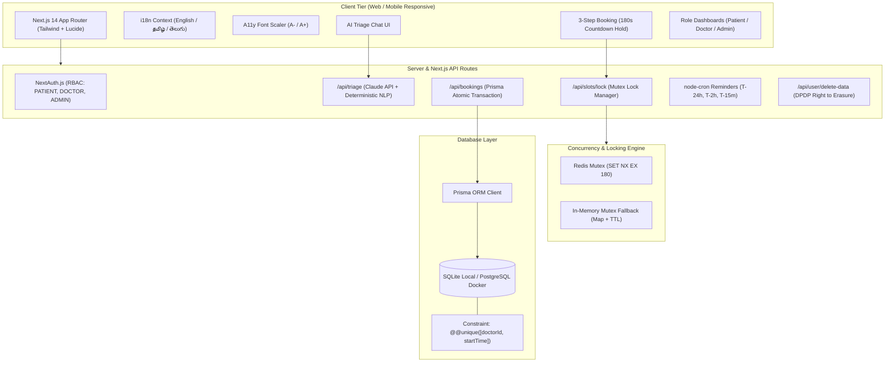

# MediBook AI – Intelligent AI Doctor Appointment System

[](https://nextjs.org/)
[](https://www.typescriptlang.org/)
[](https://tailwindcss.com/)
[](https://www.prisma.io/)
[](#zero-double-booking-architecture)
[](#security--dpdp-act-2023-compliance)

**MediBook AI** is a production-quality, fast, and accessible healthcare appointment platform where patients describe symptoms in plain language (supporting **English**, **தமிழ் (Tamil)**, and **తెలుగు (Telugu)**), get accurately routed to the right medical specialty without diagnostic jargon, and book verified appointments in under 45 seconds with guaranteed zero double-booking.

---

## 🌟 Key Features

1. **AI Clinical Triage Chat**:
   - Evaluates symptoms into **GREEN** (routine), **AMBER** (same-day priority), or **RED** (emergency stop).
   - Asks a single targeted clarifying question when symptoms cross specialty borders.
   - Claude 3.5 API integration with high-fidelity offline deterministic clinical router fallback.
   - Emergency RED tier immediately halts booking and displays emergency call button for **112** and nearest trauma center advice.
2. **Zero Double-Booking Guarantee**:
   - Dual-layer locking: Distributed Redis Mutex (`SET NX EX 180`) with an atomic in-memory mutex fallback.
   - Physical database compound constraint: `@@unique([doctorId, startTime])`.
   - Verified with a 50-request parallel race condition concurrency test.
3. **3-Step Instant Booking Wizard**:
   - Select date & slot → Review details with active 180-second countdown hold → Instant confirmation.
   - 1-Click **"Add to Calendar (.ics)"** download with built-in alarm triggers.
4. **Patient Hub & Doctor Live Queue**:
   - **My Appointments**: 1-click Reschedule modal, 1-click Cancel modal with confirmation, and **5-second Undo Toast**.
   - **Doctor Dashboard**: Today's live patient queue, AI clinical symptom summaries, status buttons (Complete / No-show), and 1-click **"Block Emergency Slot"**.
   - **Admin Analytics**: Operational KPIs, completion metrics, real-time **No-Show Rate (%)**, and specialty distribution.
5. **Security & India DPDP Act 2023 Compliance**:
   - AES-256 encrypted clinical notes at rest.
   - Zero patient PII sent to AI models (symptoms only).
   - Right to Erasure ("Delete My Data") button in profile settings permanently purging all patient records.
6. **Accessibility & Multi-Language Support**:
   - Instant language switching between **English**, **தமிழ் (Tamil)**, and **తెలుగు (Telugu)**.
   - Font size adjuster (`A-` / `A` / `A+`) for senior patients.
   - Light & dark mode toggle with persistent preferences.

---

## 🏗️ Architecture Diagram



---

## 🗄️ Database ER Diagram

```mermaid
erDiagram
    User ||--o{ Appointment : "books as patient"
    User ||--o| DoctorProfile : "has profile if doctor"
    User ||--o{ Notification : "receives"
    User ||--o{ AuditLog : "triggers"
    Specialty ||--o{ DoctorProfile : "contains"
    DoctorProfile ||--o{ Slot : "manages"
    DoctorProfile ||--o{ Appointment : "attends"
    Slot ||--o| Appointment : "booked into"

    User {
        string id PK
        string email UK
        string passwordHash
        string name
        string role "PATIENT | DOCTOR | ADMIN"
        boolean dpdpConsent
        datetime consentTimestamp
        datetime createdAt
    }

    Specialty {
        string id PK
        string name UK
        string nameTa
        string description
        string iconName
    }

    DoctorProfile {
        string id PK
        string userId FK
        string specialtyId FK
        string qualification
        int experienceYears
        float consultationFee
        float rating
        int reviewCount
        string bio
        string languages
        boolean isAvailable
    }

    Slot {
        string id PK
        string doctorId FK
        datetime startTime
        datetime endTime
        boolean isLocked
        boolean isBooked
        boolean isEmergencyBlocked
    }

    Appointment {
        string id PK
        string patientId FK
        string doctorId FK
        string slotId FK UK
        datetime appointmentDate
        string status "CONFIRMED | COMPLETED | CANCELLED | NO_SHOW"
        string urgency "GREEN | AMBER | RED"
        string encryptedSymptomNotes "AES-256"
        string triageSpecialty
        string triageReason
        string patientPhone
    }

    Notification {
        string id PK
        string userId FK
        string title
        string message
        string type
        boolean isRead
        datetime createdAt
    }

    AuditLog {
        string id PK
        string userId FK
        string action
        string detailsJson
        datetime timestamp
    }
```

---

## ⚡ Quick Start (Zero Docker Needed)

MediBook AI is designed to run 100% locally with zero paid services or Docker dependencies required:

### 1. Install & Database Setup
```bash
# Install dependencies, generate Prisma client, and seed the database
npm run setup
```

### 2. Start Development Server
```bash
npm run dev
```

The application will be live at: **[http://localhost:3000](http://localhost:3000)**

---

## 🔑 Demo Accounts

The database seed automatically initializes 3 demo personas with full test data:

| Role | Email | Password | Access Capabilities |
| :--- | :--- | :--- | :--- |
| **Patient** | `patient@medibook.ai` | `Password123!` | AI Triage, Book, Reschedule, Cancel with Undo, Download .ics, Delete My Data |
| **Doctor** | `doctor@medibook.ai` | `Password123!` | Today's Live Queue, AI Summaries, Mark Complete/No-show, Block Emergency Slot |
| **Admin** | `admin@medibook.ai` | `Password123!` | No-Show Rate Analytics, Capacity Distribution, Audit Logs |

*Quick login buttons are available directly on the `/auth/login` page for 1-click testing.*

---

## 🔒 Zero Double-Booking Architecture

MediBook AI prevents double-booking using a rigorous two-tier synchronization mechanism:

1. **Distributed Mutex Lock (180s Hold)**:
   - When a patient selects an available slot, a mutex lock is set (`SET NX EX 180`).
   - If Redis is not running, the platform seamlessly falls back to a high-speed atomic in-memory mutex store with automatic TTL expiration.
   - Any competing user attempting to select or book that same slot is rejected with **HTTP 409 Conflict**.
2. **Database Compound Unique Constraint**:
   - `@@unique([doctorId, startTime])` guarantees that even under extreme network latency or simultaneous commits, the database physically rejects duplicate records.
3. **Automated Concurrency Test**:
   ```bash
   npm run test:concurrency
   ```
   *Fires 50 simultaneous parallel requests at a single slot: exactly 1 succeeds and 49 are rejected with 409.*

---

## 🛡️ Security & DPDP Act 2023 Compliance

- **Explicit Consent**: Consent checkbox is required at user registration and recorded in `AuditLog` with an immutable timestamp.
- **AES-256 Encryption**: Patient clinical symptoms and reasons for visit are encrypted at rest using AES-256-CBC.
- **Zero PII to LLMs**: Name, phone number, and email addresses are automatically sanitized before symptom text reaches the AI triage engine.
- **Right to Erasure (Section 12)**: Patients can permanently purge their account, appointments, and medical notes in 1-click from `/profile`.

---

## 🧪 Running Automated Tests

Run the full automated test suite covering concurrency, triage JSON output, multilingual RED urgency escalation, and slot cancellation restoration:

```bash
npm run test:concurrency
```

Output:
```
=================================================
🚀 MediBook AI - Automated Test Suite
=================================================
TEST 1: 50 Simultaneous Concurrent Requests Locking One Slot
  -> Successful Locks Acquired: 1
  -> Collisions Blocked (409): 49
  ✅ PASS: Exactly ONE request acquired the mutex lock! Zero double-booking verified.

TEST 2: AI Triage Structured JSON & Schema Validation
  ✅ PASS: Triage returned valid structured JSON routing correctly to Dermatology.

TEST 3: Urgency RED Emergency Escalation (Life Threat Safety)
  ✅ PASS: All 3 emergency inputs (English, Tamil, Telugu) correctly escalated to RED tier.

TEST 4: Appointment Cancellation & Atomic Slot Return
  ✅ PASS: Slot atomically restored to available schedule after cancellation.
=================================================
Summary: 4/4 Tests Passed successfully!
=================================================
```

---

## 📄 License
MIT © 2026 MediBook AI Systems.
